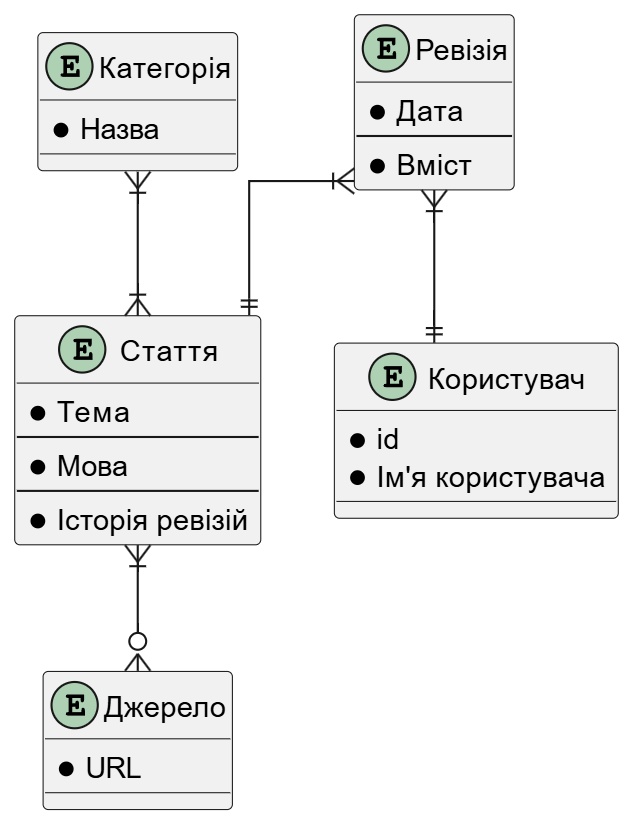

# Звіт

## Дизайн таблиць

оригінальний дизайн таблиць можна знайти у папці Lab2.
оновлений дизайн таблиць можна знайти у поточній папці.

## Порушення нормалізації та помилки у першому дизайні

1. Таблиця "article" порушувала правило нормалізації **1NF**(Усі атрибути мають бути атомарними) своїм вмістом композитного атрибуту "categories".
2. Таблиця "article" мала атрибут "sources", ідея якого було посилання на декілька полей "url" із таблиці "source". Але у імплементації можливо було посилання лише на один "url" та, навіть якщо би все працювало за метою, це поле порушувало би правило нормалізації **1NF**.
3. Таблиця "revisions_table" мала не ефективний внутрішній ключ, який не дозволяв додавати у таблицю серію ревізій зроблених одним користувачем, на одну тему, з одної мови, у один і той же день. Це сталося через те, що внутрішній ключ був декларований як **"PRIMARY KEY (revision_topic, revision_language, revision_date, user_id)"**. Для виправлення цієї структурної помилки був створений новий атрибут "relative_index SERIAL NOT NULL", який нумерує відносний індекс доданих на одну й ту саму тему та мову ревізій. Таким чином новий внутрішній ключ виглядає як "PRIMARY KEY (topic, language, relative_index)".
4. Таблицю "revisions_table" було переіменовано на "article_revisions".

## ER таблиця

З сутності "Джерело" в ER таблиці були прибрані атрибути "Назва" та "Автор", через їх відсутність у таблицях дати бази. Також було додано атрибут "id" до сутності user.

