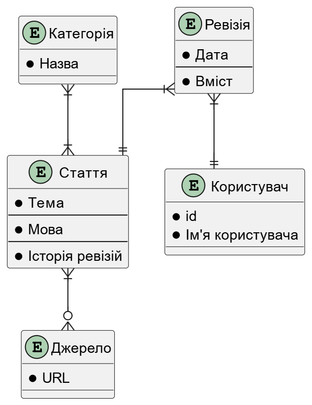

# Звіт

## Дизайн таблиць

оригінальний дизайн таблиць можна знайти у папці Lab2, файл DB.sql.
оновлений дизайн таблиць можна знайти у поточній папці, файл DB_normalized.sql.

<table>
<tr>
<td width="50%" valign="top">

**Оригінальна база даних**

<pre><code class="language-sql">
-- delete tables
DROP TABLE IF EXISTS "revisions_table";
DROP TABLE IF EXISTS "article";
DROP TABLE IF EXISTS "users";
DROP TABLE IF EXISTS "source";

DROP TYPE IF EXISTS CategoryEnum;
DROP TYPE IF EXISTS LanguageEnum;
-- table creation
CREATE TYPE CategoryEnum AS ENUM(
    'Science',
    'Politics',
    'Technology'
);
CREATE TYPE LanguageEnum AS ENUM(
    'Ukrainian',
    'English',
    'Chinese'
);
CREATE TABLE users (
    id SERIAL PRIMARY KEY,
    name varchar(100) UNIQUE NOT NULL
);
CREATE TABLE source (
    url varchar(1000) PRIMARY KEY
);
CREATE TABLE article (
    topic varchar(100) PRIMARY KEY,
    categories CategoryEnum[] NOT NULL,
    language LanguageEnum NOT NULL,
    sources varchar(1000) REFERENCES source(url),

    UNIQUE (topic, language)
);
CREATE TABLE revisions_table (
    revision_topic varchar(100),
    revision_language LanguageEnum,
    revision_date DATE NOT NULL,
    user_id INT REFERENCES users(id),
    content TEXT NOT NULL,

    PRIMARY KEY (revision_topic, revision_language, revision_date, user_id),

    FOREIGN KEY (revision_topic, revision_language) 
    REFERENCES article(topic, language)
);

-- inserts
INSERT INTO source(url)
VALUES
('http://ancienthistory.about.com/od/presocraticphiloso/p/Atomism.htm'),
('https://www.techradar.com/news/best-phone'),
('https://en.wikipedia.org/wiki/Politics#CITEREFHawkesworthKogan2013');

INSERT INTO users(id, name)
VALUES 
(1, 'asdf'),
(2, 'QWER'),
(3, 'TYUI');

INSERT INTO article(topic, categories, language)
VALUES 
('Physics', ARRAY['Science']::CategoryEnum[], 'Ukrainian'),
('Smart Phone', ARRAY['Technology']::CategoryEnum[], 'English'),
('Politics', ARRAY['Politics']::CategoryEnum[], 'Ukrainian');

INSERT INTO revisions_table(revision_topic, revision_language, revision_date, user_id, content)
VALUES 
('Physics', 'Ukrainian', '2012-11-03', 1, 'sdasdasdasd, asXCsdaX.'),
('Smart Phone', 'English', '2022-11-03', 2, 'DFCXVASD. SDvxcqacf'),
('Politics', 'Ukrainian', '2015-11-03', 3, 'Ye. SDfxcvsaa.r');
</code></pre>

</td>
<td width="50%" valign="top">

**Виправлена база даних**

<pre><code class="language-sql">
-- delete tables
DROP TABLE IF EXISTS "revisions_table";
DROP TABLE IF EXISTS "articles_normalized", "article_categories",
"article_sources", "article_revisions";
DROP TABLE IF EXISTS "users";
DROP TABLE IF EXISTS "source";

DROP TYPE IF EXISTS CategoryEnum;
DROP TYPE IF EXISTS LanguageEnum;
-- table creation
CREATE TYPE CategoryEnum AS ENUM(
    'Science',
    'Politics',
    'Technology'
);
CREATE TYPE LanguageEnum AS ENUM(
    'Ukrainian',
    'English',
    'Chinese'
);
CREATE TABLE users (
    id SERIAL PRIMARY KEY,
    name varchar(100) UNIQUE NOT NULL
);
CREATE TABLE sources (
    url varchar(1000) PRIMARY KEY
);
# прибрані атрибути "categories" - через порушення 1НФ 
# та "sources" через неправильну імлементацію
CREATE TABLE articles_normalized (
    topic varchar(100),
    language LanguageEnum NOT NULL,

    PRIMARY KEY (topic, language)
);
# нова таблиця сполучення статтею та категоріями
CREATE TABLE article_categories (
    topic varchar(100),
    language LanguageEnum,
    category CategoryEnum,
    PRIMARY KEY (topic, language, category),
    FOREIGN KEY (topic, language) REFERENCES articles_normalized(topic, language)
);
# нова таблиця сполучення між статтею та джерелами
CREATE TABLE article_sources (
    topic varchar(100),
    language LanguageEnum,
    source_url varchar(1000),
    PRIMARY KEY (topic, language, source_url),
    FOREIGN KEY (topic, language) REFERENCES articles_normalized(topic, language),
    FOREIGN KEY (source_url) REFERENCES sources(url)
);
# перероблена таблиця сполучення між статтею та ревізіями
# був доданий 'relative_index' який нумерує ревізії додані до унікальної статті,
# бо до цього користувача, додавшего дві ревізії до однієї статті у один день
# було неможоливо зареєструвати
CREATE TABLE article_revisions (
    relative_index SERIAL NOT NULL,
    topic varchar(100),
    language LanguageEnum,
    date DATE NOT NULL,
    user_id INT REFERENCES users(id),
    content TEXT NOT NULL,
    PRIMARY KEY (topic, language, relative_index),

    FOREIGN KEY (topic, language) REFERENCES articles_normalized(topic, language)
);
</code></pre>

</td>
</tr>
</table>

## Порушення нормалізації та помилки у першому дизайні

1. Таблиця "article" порушувала правило нормалізації **1NF**(Усі атрибути мають бути атомарними) своїм вмістом композитного атрибуту "categories".
2. Таблиця "article" мала атрибут "sources", ідея якого було посилання на декілька полей "url" із таблиці "source". Але у імплементації можливо було посилання лише на один "url" та, навіть якщо би все працювало за метою, це поле порушувало би правило нормалізації **1NF**.
3. Таблиця "revisions_table" мала не ефективний внутрішній ключ, який не дозволяв додавати у таблицю серію ревізій зроблених одним користувачем, на одну тему, з одної мови, у один і той же день. Це сталося через те, що внутрішній ключ був декларований як **"PRIMARY KEY (revision_topic, revision_language, revision_date, user_id)"**. Для виправлення цієї структурної помилки був створений новий атрибут "relative_index SERIAL NOT NULL", який нумерує відносний індекс доданих на одну й ту саму тему та мову ревізій. Таким чином новий внутрішній ключ виглядає як "PRIMARY KEY (topic, language, relative_index)".
4. Таблицю "revisions_table" було переіменовано на "article_revisions".

## ER таблиця

З сутності "Джерело" в ER таблиці були прибрані атрибути "Назва" та "Автор", через їх відсутність у таблиці дати бази. Також було додано атрибут "id" до сутності user.

