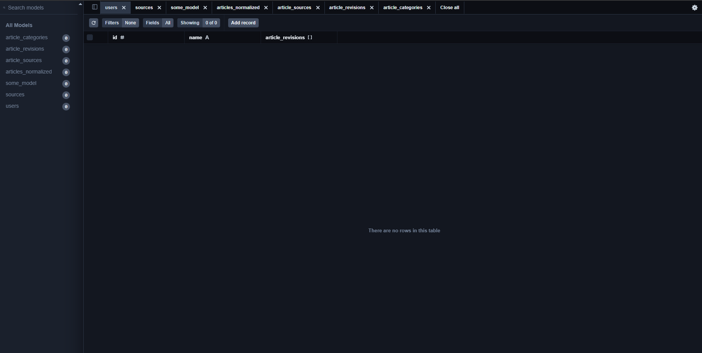
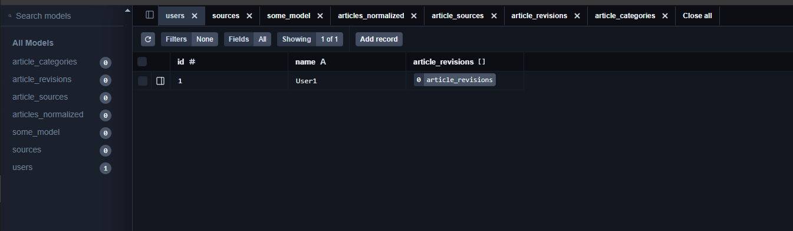

# Звіт

## Документація міграцій

1. міграція "first_migration" - міграція з оригінальним станом бази даних.
2. міграція "add_review_table" - було додано нову таблицю "some_table".
3. міграція "add_new_field" - до таблиці "some_table" було додано нову змінну.
4. міграція "drop_old_column" - з таблиці "some_table" було прибрано два поля.

## Перевірка за допомогою клієнта Prisma

Скриншоти Prisma Studio

Вставлено дані:

